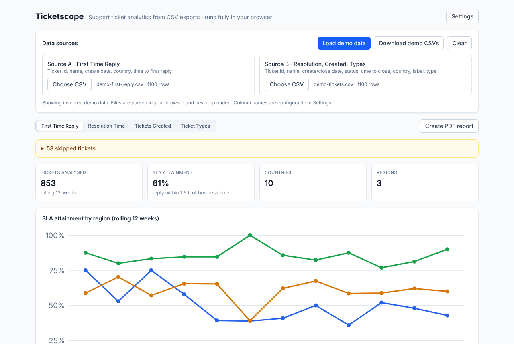

# Ticketscope

Browser-based analytics for support tickets: upload a HubSpot CSV export and get first-reply time with business hours and SLA, resolution time, ticket volume and ticket-type trends. Runs fully client-side.



## The problem

Support teams live by a few numbers: how fast do we reply, how long until a ticket is closed, how many tickets come in and what are they about. Ticketing tools report some of this, but rarely with the team's own working hours, public holidays and local timezones, and not in one view across countries. Ticketscope takes the CSV exports you already have and turns them into weekly KPIs and charts, with no backend and no data leaving your browser.

## Features

Four report modes in one UI:

- **First Time Reply**: timezone conversion per country (DST-aware), reply time measured in **business time** only (working hours, weekends and holidays excluded), configurable SLA threshold, count / average / median / P90 / min / max and **SLA attainment** per country and ISO week, rolling 12-week charts per region and per country
- **Resolution Time**: rolling 12-week and year-to-date KPIs, currently open tickets (split by product / sales / support), median, P90, closed within 24 h / 48 h, product and sales escalation rates, weekly trend
- **Tickets Created**: rolling 12-week volume with country filter, internal vs. external split (from the ticket label)
- **Ticket Types**: chart-first view with a volume / share toggle, weekly trend (top 5 + Other), rolling mix (top 8 + Other), KPI cards, type filter on the detail rows

Across all modes:

- CSV upload with column validation in the browser; **column names are configurable**
- The current ISO week is excluded automatically
- Skipped rows are summarised by reason instead of listed one by one (e.g. *"50 tickets skipped because country is empty"*)
- CSV export of aggregations and row-level detail
- All settings are stored in `localStorage`
- **PDF report**: print view in A4 landscape (title page plus a charts page and a KPI page per view), saved via the browser print dialog
- **Demo data**: one click loads an invented ticket set, no real data needed

## How it was built

The original version of this tool was built with **Codex**. The source of that version is no longer available, so this public version was **re-implemented from its feature description with Claude Code**. It follows the same feature set, but it is a fresh codebase and not a copy, and some details (for example the exact business-time and percentile methods, listed below) are my own definitions. Everything company-specific from the original (names, accounts, report links, field names) is left out, and the demo data is invented.

## Tech stack

- [Next.js 15](https://nextjs.org/) (App Router), React 19, TypeScript
- Tailwind CSS 4
- [Papa Parse](https://www.papaparse.com/) for CSV, [Luxon](https://moment.github.io/luxon/) for timezones and DST
- Hand-written SVG charts (no chart library)
- Vitest for the analysis logic

## Quick start

```bash
npm install
npm run dev
```

Open [http://localhost:3000](http://localhost:3000) and click **Load demo data**. No environment variables or accounts are needed.

```bash
npm test          # unit tests for the analysis logic
npm run typecheck
npm run build
```

## Using your own data

The app expects two CSV exports (they can be the same file if it contains all columns). Header names are the defaults and can be changed in **Settings → CSV column names**.

| Report | Source | Required columns |
|---|---|---|
| First Time Reply | A | `Record ID`, `Ticket name`, `Create date`, `Country`, `Time to first agent email reply` |
| Resolution Time | B | `Record ID`, `Ticket name`, `Create date`, `Close date`, `Ticket status`, `Time to close`, `Country`; optional `Escalation ticket`, `Sales escalation date` |
| Tickets Created | B | `Record ID`, `Ticket name`, `Create date`, `Country`, `Ticket label` |
| Ticket Types | B | `Record ID`, `Ticket name`, `Create date`, `Country`, `Ticket type` |

Timestamps are read as ISO or `yyyy-MM-dd HH:mm[:ss]` in the **source timezone** (default UTC). Duration columns are numbers in the configured unit (default milliseconds). In **Settings** you also set the SLA threshold, the statuses that count as closed, and per country the timezone, region, working hours and holidays. The holiday presets are only examples (New Year, Christmas), please adjust them.

## Metric definitions

- **Weeks**: ISO weeks. Charts show the last 12 complete weeks; the current week is excluded in every mode (First Time Reply by the ticket's local week, the others by the week in the source timezone).
- **First reply (business time)**: reply time = create time + elapsed first-reply duration. Business minutes are the part of that interval inside the country's working hours, in the country's local time, excluding non-working days and holidays. **SLA attainment** = share of tickets with business minutes ≤ the threshold.
- **Percentiles**: linear interpolation (like Excel's `PERCENTILE.INC`).
- **Resolution**: closed tickets are grouped by the week of their close date. Open tickets are the current state: *with product* if an escalation value is set, else *with sales* if a sales escalation date is set, else *with support*.
- **Internal vs. external**: a ticket is internal if its label contains "internal" (case-insensitive).
- **Ticket types**: top 5 (weekly trend) and top 8 (mix) by volume in the window, everything else is Other.

## Project structure

```
app/                 # Next.js entry (layout, page)
components/          # Report views, charts, upload, settings, print report
lib/
  analysis-*.ts      # One module per report mode
  prepare.ts         # Typed tickets from CSV rows, with skip reasons
  csv.ts             # Parsing, column validation, dates and durations
  demo.ts            # Deterministic invented demo data
tests/               # Vitest unit tests
```

## License

[MIT](LICENSE)
